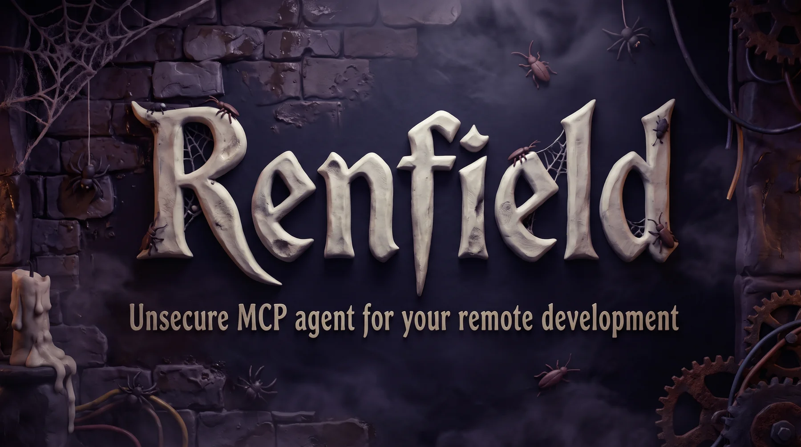

<p align="center">
  
</p>

# renfield

Run commands, edit files and copy files on another machine over a secure connection, with no `sshd` and nothing to install except one small executable.

```
 Linux (source)                                   Windows (dest)
 ┌──────────────────────────┐   TLS 1.3, both    ┌──────────────────────────┐
 │ Claude Code ──► renfield │   sides pinned     │ renfield listen          │
 │ or you      ──► renfield │ ◄────────────────► │   runs the command in    │
 │      exec / put / get    │                    │   cmd, PowerShell, bash  │
 └──────────────────────────┘                    └──────────────────────────┘
```

`renfield` is one executable with two roles:

- **dest** listens on a port, runs the commands it receives in its own shell and answers.
- **source** connects to a dest it has been paired with and sends commands and requests.

Any machine can be source or dest (Linux and Windows are supported; the code does not prevent macOS). The main user is **Claude Code**: `renfield mcp` is an MCP server that gives Claude tools to run commands, read, write and edit text files and copy files on the other machine, almost as if it were local. The command line is there for manual use and scripts.

renfield is **non interactive**: no terminal, no input for the commands you run, so no `vim`, `top` or password prompts on the other side.

<p align="center">
  
</p>

## Contents

1. [Install](#1-install)
2. [Five minute tour](#2-five-minute-tour)
3. [Pairing in detail](#3-pairing-in-detail)
4. [Running commands: `exec`](#4-running-commands-exec)
5. [Copying files: `put` and `get`](#5-copying-files-put-and-get)
6. [Use with Claude Code](#6-use-with-claude-code)
7. [Managing machines and keys](#7-managing-machines-and-keys)
8. [Running dest day to day](#8-running-dest-day-to-day)
9. [Configuration](#9-configuration)
10. [Security model](#10-security-model)
11. [Exit codes](#11-exit-codes)
12. [Troubleshooting](#12-troubleshooting)
13. [How it works](#13-how-it-works)
14. [Status and limits](#14-status-and-limits)
15. [Development](#15-development)

## 1. Install

Copy the executable to each machine. There is nothing else to install: no runtime, no libraries, no service.

| Machine | File | Notes |
| --- | --- | --- |
| Linux | `renfield` | Static binary, runs on any distribution. |
| Windows | `renfield.exe` | Uses only DLLs that ship with Windows. |

Put it somewhere in your `PATH` (for example `/usr/local/bin` or a folder you add to the Windows `PATH`). Check it with:

```
renfield --version
```

Build from source (Rust stable, edition 2024):

```bash
cargo build --release                                      # for this machine
cargo build --release --target x86_64-unknown-linux-musl   # static Linux binary
cargo build --release --target x86_64-pc-windows-gnu       # Windows exe, cross compiled from Linux
```

The binaries end up in `target/<target>/release/`.

## 2. Five minute tour

You have a Linux machine you work on (the **source**) and a Windows machine you want to command (the **dest**), on the same network. The Windows machine is at `192.168.1.20`.

**1. On Windows (dest)**, open a terminal and start renfield in pairing mode:

```
renfield listen --accept-key
```

```
renfield listening on port 47822, key fingerprint 5ef6c9e2...
Pairing mode: accepting a new key for the next 120 seconds.
```

**2. On Linux (source)**, pair with it, giving the machine a name of your choice (`win-pc`):

```
renfield pair win-pc 192.168.1.20:47822
```

Both terminals now show the same two keys, with the labels swapped:

```
Pairing request from 'fabio-office' at 192.168.1.10:55402.        <- on Windows
  This machine's key:   5ef6c9e29d68cde7...
  Other machine's key:  b21145c1ca741fb7...
The same two keys must appear on the other machine, with the labels swapped.
Accept this key? [y/N]
```

Check that the fingerprints match, answer `y` on Windows, then `y` on Linux. Only then do both machines save the keys.

**3. Use it.** From now on, whenever `renfield listen` is running on Windows:

```bash
renfield exec win-pc -- "dir C:\projects"
renfield put win-pc ./app.zip 'C:\temp\app.zip'
renfield get win-pc 'C:\temp\build.log' ./build.log
```

Pairing is done once. Next time just start `renfield listen` (without `--accept-key`) on Windows.

## 3. Pairing in detail

Pairing is how two machines learn each other's key. It is deliberately manual: no machine ever trusts a key it has not been told to trust by a human looking at both screens.

### The steps

1. **Dest** runs `renfield listen --accept-key [--timeout SECS]`. For `--timeout` seconds (default 120) it will accept **one** pairing attempt. It keeps running as a normal dest afterwards.
2. **Source** runs `renfield pair <name> <host:port>`. `<name>` is the name you will use from now on; `<host:port>` is the dest's address (an IP address or a DNS name, and the port dest listens on).
3. **Dest** shows the source's key and asks `Accept this key? [y/N]`.
4. If dest accepts, **source** shows dest's key and asks `Trust this machine? [y/N]`.
5. Only when both answered yes are the keys saved: dest adds the source to its list of authorized keys, source adds dest (name, address and key) to its registry.

If anyone answers no, the window expires, or the network drops, **nothing is saved on either side**. Questions that nobody answers expire after 5 minutes (taken as no).

### What to compare

Each screen shows two fingerprints, "This machine's key" and "Other machine's key". They are the same two values on both screens, with the labels swapped: the one that is "this machine" on Linux is the "other machine" on Windows. If an attacker on your network tried to intercept the pairing, the fingerprints would differ. Always compare them, at least the first and last few characters.

### Rules and limits

- Only one pairing at a time. A second source gets `pairing in progress, try again later`.
- The window closes after the first decision (accepted or rejected) or when time is up. To pair another machine, restart `renfield listen --accept-key`.
- If the source disappears while dest waits for you, the window stays open for a retry.
- `pair` refuses a name that is already in the registry, **before** asking anything. Use `--force` to replace it.
- The name the source presents to dest is its host name, reduced to letters, digits, `.`, `_` and `-` (at most 64 characters). Dest shows it in the question and uses it as a label.

### Pairing in both directions: `--both`

A normal pairing gives the source power over the dest and **nothing else**. If the dest must also command the source (so you can work in both directions), pair with `--both`:

```
# on the source: it must also be listening
renfield listen
# on the dest: window open
renfield listen --accept-key
# on the source:
renfield pair win-pc 192.168.1.20:47822 --both [--listen-port 47822]
```

With `--both`, one confirmation grants both directions, and both questions say so explicitly:

```
  --both: this machine will also be able to command 'fabio-office'.     <- on dest
  --both: 'win-pc' will also be able to command this machine.           <- on source
```

`--listen-port` is the port the source listens on, told to dest so it can reach back (default 47822). The address dest records for the source is the one it saw the connection come from, plus that port. After this, on the dest: `renfield exec fabio-office -- ...` works too.

### Pairing again and changed keys

- If a machine's identity is deleted or reinstalled (its `identity.key` is gone) it gets a new key. A source then refuses to talk to it with `the key of 'win-pc' is different from the one pinned at pairing` (exit code 203). That is the protection against an impostor working. If the change is expected, on the source run `renfield remove win-pc`, then pair again.
- A dest whose `authorized.toml` was lost has to authorize its sources again by pairing again.

## 4. Running commands: `exec`

```
renfield exec <name> [--shell SHELL] [--cwd DIR] [--timeout SECS] -- <command...>
```

The output arrives in real time: the remote standard output goes to your standard output, the remote standard error to your standard error. renfield exits with the **remote exit code**, so it works in scripts and `&&` chains.

```bash
renfield exec win-pc -- "hostname"
renfield exec win-pc --cwd 'C:\projects\app' -- "git status"
renfield exec win-pc --timeout 600 -- "build.bat"
renfield exec build-box -- "exit 3"; echo $?        # prints 3
```

### One argument or several

- **One argument** is a command line for the remote shell, exactly as if you typed it there, so pipes, `&&`, redirections and variables work. Quote it for your *local* shell:

  ```bash
  renfield exec build-box -- "cd /srv/app && make test 2>&1 | tail -20"
  ```

- **Several arguments**: the first is the program and each of the others is passed to it **unchanged**. renfield protects spaces, quotes and special characters for the remote shell, so you do not have to think about remote quoting:

  ```bash
  renfield exec build-box -- grep -n "hello world" notes.txt
  renfield exec build-box -- printf '%s\n' 'x;y' '$HOME'      # prints x;y and $HOME literally
  ```

  In this form nothing is interpreted by the remote shell (no pipes or variables). In `cmd` a literal `%` cannot be protected.

### Shells

`--shell` chooses the shell on the remote machine:

| Value | Runs | Default on |
| --- | --- | --- |
| `bash` | `bash -c` | Linux (if `bash` exists) |
| `sh` | `sh -c` | Linux (otherwise) |
| `powershell` | Windows PowerShell 5.1 (`powershell.exe`), UTF-8 output | Windows |
| `pwsh` | PowerShell 7, if installed | |
| `cmd` | `cmd /C`, UTF-8 code page | |

```bash
renfield exec win-pc --shell cmd -- "echo %USERNAME% & ver"
renfield exec win-pc --shell pwsh -- "Get-Process | Select-Object -First 3"
```

### Working directory

Without `--cwd`, commands start in the **home directory of the user running dest** (or the `default_cwd` of its [configuration](#9-configuration)). `--cwd` accepts an absolute path in the remote machine's own format, `~`, or a path relative to that home directory.

### Timeouts

By default a command may run as long as it needs. `--timeout SECS` kills it (and everything it started) after that time; renfield then exits with code 204. A dest can also impose a maximum (`max_timeout_secs`), which applies even when you ask for more.

### What you can and cannot do

- There is no input: the command's standard input is empty. Commands that wait for a key press or a password will just wait (until a timeout kills them).
- If you press Ctrl-C locally, the connection closes and the dest **kills the remote command and everything it started**.
- Output is not interpreted: bytes that are not text pass through untouched.

## 5. Copying files: `put` and `get`

```
renfield put <name> <local> <remote>      # this machine -> the other
renfield get <name> <remote> <local>      # the other machine -> this one
```

```bash
renfield put win-pc ./app.zip 'C:\temp\app.zip'
renfield get win-pc 'C:\Users\me\log.txt' ./log.txt
renfield get build-box '~/out/app.tar.gz' ./app.tar.gz   # give a file name, not a directory
```

- One file at a time, any size, any content (binary safe). There is no directory transfer: pack a folder (`zip`, `tar`) first.
- The data is streamed, never loaded in memory. Files of 8 MiB or more show a progress counter on standard error.
- A SHA-256 checksum is verified before the file appears. The destination is written under a temporary name (`<name>.renfield-part`) and renamed only when everything is correct, so a failed or interrupted transfer never leaves a half written file, and an existing file is never replaced by a broken one.
- Missing parent directories are created. An existing file is overwritten.
- `<remote>` follows the [path rules](#paths-on-the-remote-machine). `<local>` is a normal local path.

### Paths on the remote machine

Remote paths are written in the **native format of the remote machine**: `C:\Users\me\x` on Windows, `/home/me/x` on Linux. A leading `~` is the home directory of the user running dest, and relative paths start from that home. In a local Linux shell, quote Windows paths with single quotes so backslashes are not interpreted.

## 6. Use with Claude Code

`renfield mcp` is an [MCP](https://modelcontextprotocol.io) server that talks over standard input and output. Register it on the machine where Claude Code runs (the **source**):

```
claude mcp add renfield -- renfield mcp
```

Use `--scope user` to make it available in every project:

```
claude mcp add --scope user renfield -- renfield mcp
```

It uses the same registry and keys as the command line, so the machines you paired with `renfield pair` are available immediately. Claude Code's permission prompts for these tools are your access control on the source side: approve them as you would any command that can change files.

### The tools

Every tool takes `machine`, the name you gave at pairing.

| Tool | Arguments | What it does |
| --- | --- | --- |
| `remote_exec` | `command`, `shell`, `cwd`, `timeout_secs` | Runs a command and returns its exit code, stdout and stderr. Default timeout 120 s. Each stream is capped at 1 MiB (the end is kept, and the answer says so). A command that is killed by its timeout is reported as an error. |
| `remote_read` | `path`, `offset`, `limit` | Reads a UTF-8 text file with numbered lines, like `cat -n`. `offset` is the first line (1-based) and `limit` the number of lines. At most 1 MiB per call; the answer tells how to continue. Binary files are refused with a hint to use `remote_get`. |
| `remote_write` | `path`, `content` | Creates or overwrites a text file (parent directories are created, existing CRLF line endings are kept, the write is atomic). For binary files or more than 8 MiB use `remote_put`. |
| `remote_edit` | `path`, `old_string`, `new_string`, `replace_all` | Replaces an exact string, like the local Edit tool. Fails if the string is missing, or appears more than once (unless `replace_all`). CRLF files are handled; a file with mixed line endings is matched literally. Permissions and symbolic links are preserved. |
| `remote_list` | `path`, `recursive` | Lists a directory: kind, size, modification time (UTC) and name. Hidden files included. At most 10000 entries. |
| `remote_put` | `local_path`, `remote_path` | Copies a file from the machine running Claude Code to the remote machine. |
| `remote_get` | `remote_path`, `local_path` | Copies a file from the remote machine to the machine running Claude Code. |

Calls run concurrently, so Claude can work on several machines (or run several commands) at once. Failures come back as readable tool errors that say what went wrong and what to try, not as protocol crashes.

### Example conversation

> **You:** On `win-pc`, in `C:\projects\app`, fix the failing test in `tests\parser_test.cs`, then run the tests and show me the result.
>
> **Claude:** *(uses `remote_read`, `remote_edit`, then `remote_exec` with `dotnet test` and `cwd`)*

Tips:

- Tell Claude the machine name and the project directory on the other side ("on `win-pc`, in `C:\projects\app`").
- Windows paths work as they are; Claude does not need to convert them.
- If a command may run longer than two minutes, ask for a longer `timeout_secs`.

## 7. Managing machines and keys

### Machines you can command (on the source)

```
renfield list
```

```
NAME                 ADDRESS                  KEY
win-pc               192.168.1.20:47822       5ef6c9e29d68cde7
build-box            192.168.1.30:47822       a9140b27c3e51f08
```

`KEY` is the start of the pinned fingerprint. To forget a machine:

```
renfield remove win-pc
```

`remove` only deletes it from *your* registry. The key you had authorized on that machine stays valid there until someone revokes it on that machine.

### Who may command this machine (on the dest)

```
renfield authorized list
```

```
LABEL                FINGERPRINT
fabio-office         b21145c1ca741fb7900ccef95af4cdf12d7a669907e0e8a5b818c4fd848ed589
```

To withdraw access, revoke by label or by the full fingerprint:

```
renfield authorized revoke fabio-office
```

It takes effect at once: the next request from that key is refused (even on a connection that is already open), and it can no longer connect.

## 8. Running dest day to day

- Start it with `renfield listen` in a terminal. It runs until you stop it (Ctrl-C). renfield has no service mode yet; to keep it running in the background use what your system offers (`tmux`/`screen`/`systemd --user` on Linux, a scheduled task or a startup shortcut on Windows).
- Dest runs commands as the user that started it, with that user's permissions. See the [security model](#10-security-model).
- **Windows firewall:** the first time, Windows may ask whether to allow `renfield.exe` on the network; allow it on private networks. Or add a rule yourself, from an administrator terminal:

  ```
  netsh advfirewall firewall add rule name="renfield" dir=in action=allow protocol=TCP localport=47822
  ```

- **Port in use:** change the port with `--port` or `config.toml` (`cannot listen on port N: Address already in use` tells you).
- **Audit log:** every request served is printed on the dest's console, one line each, with the time (UTC), who asked, what and the result:

  ```
  [2026-10-21 07:42:50] fabio-office exec 'echo hello' -> exit 0
  [2026-10-21 07:42:50] fabio-office put C:\users\public\in.bin (5000000 bytes) -> ok
  [2026-10-21 07:42:51] fabio-office read C:\app\notes.txt -> ok
  [2026-10-21 07:42:52] a1b2c3d4e5f6 exec 'whoami' -> refused: key not authorized
  ```

  Redirect it to a file if you want to keep it (`renfield listen >> renfield.log`).
- Connections that stay silent are dropped after 10 seconds, so a port scanner cannot hold dest's resources.

## 9. Configuration

### Files

The configuration directory is `~/.config/renfield/` on Linux and macOS and `%APPDATA%\renfield\` on Windows. Set the environment variable `RENFIELD_HOME` to use another directory (handy for tests, or to run two identities on one machine).

| File | Content |
| --- | --- |
| `identity.crt`, `identity.key` | This machine's certificate and private key. Created on first use; the key is readable only by its owner. **Keep `identity.key` private and never copy it to another machine.** |
| `registry.toml` | Machines this one can command: name, address, pinned fingerprint. |
| `authorized.toml` | Keys allowed to command this machine, with their labels. |
| `config.toml` | Optional dest settings (below). |

`registry.toml` and `authorized.toml` are plain TOML that you can read, and edit if you really need to; the commands above are the safe way.

### `config.toml` (dest)

```toml
port = 47822              # TCP port to listen on
default_cwd = "~/work"    # working directory when the caller gives none (default: home)
max_timeout_secs = 3600   # no command may run longer than this
```

All keys are optional, and unknown keys are rejected (a typo is reported instead of ignored). The command line wins over the file: `renfield listen --port 5000` overrides `port`. Use `--config FILE` to read another file; a file given this way must exist.

### Environment

| Variable | Effect |
| --- | --- |
| `RENFIELD_HOME` | Use this directory instead of the default configuration directory. |

## 10. Security model

- **Transport.** TLS 1.3 only, with **mutual authentication**. Each machine has a self signed Ed25519 certificate. Peers are recognised by the SHA-256 fingerprint of that certificate, pinned at pairing time. There are no passwords, no certificate authorities and no host names to spoof.
- **Login is only by key exchange.** A dest refuses every key it does not know. The single exception is the short, manually confirmed pairing window.
- **Pairing needs a human on both machines**, comparing the fingerprints. See [Pairing in detail](#3-pairing-in-detail).
- **Impostor protection.** If a dest presents a different key from the one pinned, the source stops before sending anything (exit code 203).
- **Revocation.** `renfield authorized revoke` takes effect immediately, including on open connections.
- **Hardening.** Unauthenticated peers cannot make dest allocate big buffers or hold connections open; names shown in the pairing question are restricted to safe characters so a hostile peer cannot fake the screen where you compare fingerprints; private keys are created owner-only.
- **Audit.** Every request dest serves is logged on its console.

> **A dest is not restricted.** Whoever is authorized can run *any* command and read or write *any* file the OS user that started dest can. There is no sandbox, no list of allowed commands and no path limit. This is a design decision: renfield replaces a remote shell. So:
>
> - run dest as a user with only the rights you are willing to hand out (not as administrator or root unless you mean it);
> - pair only machines you trust, and revoke keys you no longer need;
> - when Claude Code is the source, its per tool confirmations are your access control on the source side.

renfield protects the connection and the login. It does not protect you from commands you authorize.

## 11. Exit codes

`renfield exec` exits with the exit code of the remote command (if the command was killed by a signal, `128 + signal`, as shells do). renfield's own failures use a reserved range, so scripts can tell them apart:

| Code | Meaning | Usual fix |
| --- | --- | --- |
| 200 | Cannot connect to the machine. | Is `renfield listen` running there? Address, port, firewall. |
| 201 | The name is not paired. | `renfield list`; `renfield pair <name> <host:port>`. |
| 202 | The machine does not authorize this key. | Pair again (`listen --accept-key` there, `pair` here). |
| 203 | The machine's key changed since pairing. | If expected: `renfield remove <name>`, then pair again. |
| 204 | The remote command was killed by the timeout. | Raise `--timeout`. |
| 205 | Protocol error. | Use the same renfield version on both machines. |
| 206 | Wrong usage (also: revoking something that does not exist). | Check the command. |
| 207 | I/O error, or the machine reported an error. | Read the message. |

A remote command can itself exit with one of these numbers; renfield cannot tell the difference, so avoid those values in commands you run through it.

## 12. Troubleshooting

| You see | Meaning and fix |
| --- | --- |
| `cannot connect to 'win-pc' at 192.168.1.20:47822: Connection refused` | Nothing is listening: start `renfield listen` on that machine, check the port. |
| `cannot connect to 'win-pc' at ...: timed out` | Nothing answered within 10 seconds: a firewall drops the traffic, or the address is wrong. Open the port (see [day to day](#8-running-dest-day-to-day)). |
| `this machine is not authorized on 'win-pc'. On 'win-pc' run 'renfield listen --accept-key', then here run 'renfield pair ...'` | The dest does not know this machine's key (never paired, or the key was revoked). Pair again. This message is also shown when the connection dies before the dest says anything. |
| `the key of 'win-pc' is different from the one pinned at pairing` | The dest has a new identity (reinstall, deleted `identity.key`) or somebody is impersonating it. Make sure which; if expected, `renfield remove win-pc` and pair again. |
| `'win-pc' is not paired. Pair it first: renfield pair win-pc <host:port>` | Wrong name. See `renfield list`. |
| `this machine is not accepting new keys. Start it with: renfield listen --accept-key` | You tried to pair with a dest that is not in pairing mode (or its window has closed). |
| `pairing in progress, try again later` | Another pairing is running on that dest. |
| `machine 'win-pc' is already registered, use --force ...` | The name exists. Pick another name or pass `--force`. |
| `pairing cancelled, nothing was saved` / `pairing rejected on the other machine` | One side answered no, or nobody answered in time. Nothing was stored; try again. |
| `invalid source name` | The pairing name contains characters other than letters, digits, `.`, `_`, `-`, or is longer than 64 characters. |
| `cannot start shell 'powershell.exe' on this machine (pick another with --shell)` | That shell does not exist there; choose another (`--shell cmd`, `sh`, ...). |
| `working directory ... does not exist on this machine` | Wrong `--cwd`. Remember it is a path on the *remote* machine. |
| `string not found in ...` (remote_edit) | `old_string` differs from the file (spaces, line endings). Read the file again and copy the exact text. |
| `found N matches ... add more context ... or use replace_all` (remote_edit) | The string is not unique. Add surrounding lines, or pass `replace_all`. |
| `... is not UTF-8 text, use remote_get to copy it` | Binary file. Copy it with `get` / `remote_get`. |
| `checksum mismatch ... nothing was saved` | The file was corrupted in transit or changed while sending. Retry; the destination was not touched. |
| `cannot listen on port N: Address already in use` | Another program (or another renfield) uses the port: choose another with `--port`. |

## 13. How it works

- **One connection per operation.** `exec`, `put`, `get` and every MCP tool call open their own TLS connection to the dest, which makes concurrent calls independent.
- **Wire format.** After the TLS handshake, peers exchange frames: a 4 byte length, one kind byte (JSON message or raw data) and the body. Control messages are JSON; command output and file contents travel as raw data frames, so binary data needs no encoding. Frames are limited to 16 MiB and read incrementally.
- **Command execution.** Dest starts the chosen shell with no input, in its own process group (on Windows, with a hidden console of its own), and streams stdout and stderr back as they are produced. On timeout, or when the source disconnects, the whole process tree is killed.
- **File operations** run on dest in the same way for every operation: edits and writes go to a temporary file in the same directory and are renamed into place; existing permissions and symbolic links are preserved.
- **Transfers** stream 256 KiB data frames followed by a SHA-256 trailer; the receiver verifies it before the rename.
- **Authorization** is checked on every request against `authorized.toml`, so a revoke applies at once.

## 14. Status and limits

**Verified.** Linux: unit tests and end to end tests (121 tests), a static musl build, and the MCP server driven over standard input and output like a real client. Windows: the executable builds with only system DLLs; pairing, `cmd`, exit codes, timeouts, file operations and transfers with `C:\` paths were exercised against `renfield.exe` running under Wine, as was the unit test suite.

**Not verified yet.** It has not been run on a real Windows machine, and Windows PowerShell (`--shell powershell`, the Windows default) has never been executed (only the way its command line is built is tested). Try those first on your own Windows machine. The CI workflow in `.github/workflows/ci.yml` has not run yet (the repository has no remote).

**Not included.**

- Interactive sessions (a terminal, `vim`, prompts).
- Directory transfer, resuming an interrupted transfer.
- Running dest as a service or daemon.
- NAT traversal or discovery: source needs to reach dest's address and port directly (same LAN, a VPN, or a forwarded port).
- Restricting what an authorized source can do on a dest.
- Ready made macOS builds (the code does not prevent them).

**Good to know.**

- Text files are read and written as UTF-8. A file over 64 MiB cannot be read as text; use `get`.
- Both machines should run the same renfield version.
- Clocks do not matter: renfield does not depend on certificate dates.

## 15. Development

```bash
cargo test                       # unit and end to end tests (Linux)
cargo clippy --all-targets -- -D warnings
cargo fmt --check
cargo check --target x86_64-pc-windows-gnu
```

The end to end tests start a real dest in the test process and also drive the compiled `renfield` binary; they use unix shells (`bash`, `sleep`, `pgrep`). Source layout:

| Path | Responsibility |
| --- | --- |
| `src/main.rs`, `src/cli.rs`, `src/commands.rs` | Command line: parsing and the subcommands. |
| `src/server.rs` | Dest: accepts connections, authorizes every request, audit log. |
| `src/client.rs` | Source: connects and issues requests (`Conn`). |
| `src/tls.rs` | Mutual TLS 1.3 with pinned fingerprints. |
| `src/proto.rs` | Frames and the request and answer messages. |
| `src/pairing.rs`, `src/prompt.rs` | The two phase pairing and the yes/no questions. |
| `src/exec.rs` | Shells, quoting, streaming, timeouts, process tree kill. |
| `src/files.rs`, `src/transfer.rs` | Text file operations; file transfer. |
| `src/mcp.rs` | The MCP server and its tools. |
| `src/store.rs`, `src/identity.rs`, `src/home.rs`, `src/config.rs` | Registry and authorized keys, machine identity, config directory, `config.toml`. |
| `src/error.rs`, `src/timefmt.rs` | Errors and exit codes; UTC time formatting. |

The design document is `docs/superpowers/specs/2026-10-21-renfield-design.md` and the implementation plan `docs/superpowers/plans/2026-10-21-renfield.md`. `CHANGES.md` lists what changed, in order.

## License

MIT, see `LICENSE`.
